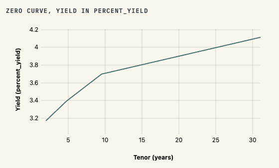
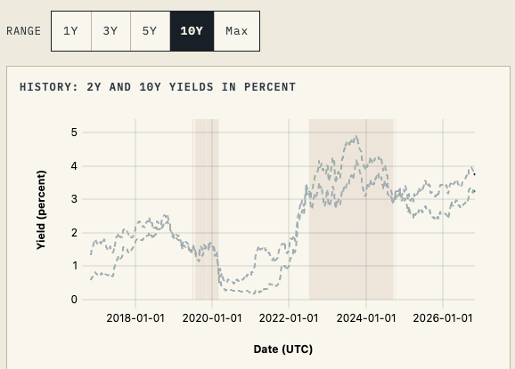

# Government of Canada Rates Monitor

Live site: https://ajeet-krish.github.io/goc-rates-monitor/

A daily Government of Canada rates desk that turns official closing prints into a verified zero curve, funding cost, and inflation picture.

This desk is an end of day reader, not a real time terminal: sources publish on a next day rhythm, so each run resolves the previous business day, waits for the Bank of Canada print, and fails closed when any named check does not pass. Think of it as a morning briefing page that shows what yesterday closed at and why you can trust it.

## Screenshots

## Primary Features

1. Date time travel and compare overlay: pick a snapshot date from the toolbar, add a compare date to overlay it, step one published day at a time with the left and right arrow keys or the Prev and Next buttons, and share any view by copying the page address, since the asof and compare values travel in the query string.
2. Six section pages, Curve, Funding, Inflation, Breaks, Verification, and Methods, behind the Desk landing view, each with sortable tables, CSV export, and a shared history range selector (1Y, 3Y, 5Y, 10Y, and Max in years).
3. Fail closed verification: any failed check turns the affected values to NA, blocks the derived pages with an explanation, and blocks the build itself.

## Page by page

### Desk

Today in one view. The headline "Bootstrapped zero curve from benchmark YTMs" sits above a knot table with Input YTM and Zero in percent yield and Discount as a unitless ratio, plus a "Bootstrapped zero curve" line chart plotting solved zeros against tenor in years. The ledger card carries 2Y yield and 10Y yield in percent, the 2s10s slope and the Canada minus United States 10Y gap in basis points, and the carry roll in basis points. A solved zero missing for a tenor plots as a gap and is never filled from the input YTM, and the 2s10s slope is read from the stored backtest, NA until the pipeline publishes a slope series.

### Curve

Answers whether quoted yields and solved zeros agree, since quotes go in and mathematically solved zeros come out. The "Zero curve" line chart (yield in percent against tenor in years) gains a dashed compare curve when a compare date is set, and the knot table gains Compare zero in percent yield and Delta versus compare in basis points columns. The "Discount function, unitless_ratio" line chart draws discounts on a unitless axis against tenor in years. Sparse instrument disclosure lists coupon in percent, cashflow counts, dirty price per 100 face, and reprice error in basis points beside the solved discount anchors. History adds the "Benchmark yield history" multi series line of 2Y and 10Y yields in percent with shaded inversion bands (2s10s below 0 basis points) and percentile captions (p10, p50, p90, and the latest rank percent over the selected range), plus the "2s10s slope history" line in basis points with the same shading. Backfilled spans render dashed and muted until a snapshot seals them.

### Funding

What it costs to hold the trade. The carry and risk card shows carry roll in basis points, horizon in years (0.25 years), DV01 per million face, and modified duration in years; the CORRA card shows value date, publication date, and date role, since CORRA value dates lag publication by one business day. The "Canada minus US spread by tenor" multi series line chart plots cross border spreads in basis points for 2Y, 5Y, 10Y, and 30Y above a spread table with CA and US yields in percent and the spread in basis points, and the whole block is withheld with a printed reason when the United States leg is unavailable. The "10Y spread history" line chart in basis points carries solid verified and dashed backfilled spans with a percentile caption.

### Inflation

Separates final publisher prints from experimental core replicas. The publisher versus experimental card reads trim and median in percent year over year for the reference month, the decomposition table gives each component rate in percent per month, weight in percent, and contribution in percentage points with kept and excluded weight fractions, and the validation flag shows MAE in percentage points against the gate over the measured months, a flag that never blocks the build. The tax window flag covers December 2024 to March 2026, and the weight vintage card records expenditure year, link month, and bulk hashes. The "Core inflation history" multi series line chart plots trim and median in percent per month, solid verified and dashed backfilled, with a percentile caption and one uniform CPI vintage.

### Breaks

Tells you when a benchmark bond was switched so you never mistake a substitution for a market move. The switch register lists events with feed, vintage, and digest, plus incoming and outgoing maturity and coupon in percent. The gate table classifies each tenor's day over day move in basis points as comparable, switch_break, calendar_gap, missing_prev, or insufficient_history, with nulls naming their reason and a break threshold of 15.0 basis points. The "Backtest slopes" line chart shows the fixed 2s10s mean reversion sketch in basis points with rule, observation count, and total PnL in basis points, gross by construction. History adds the "10Y yield history" line chart in percent with solid verified and dashed backfilled spans, and its caption explains that switch windows suppress day over day deltas while calendar gaps keep the number with a flag.

### Verification

The trust page, where every check passes or the desk visibly blocks derived values. The header counts passed, failed, and total checks at 1.0 basis points of tolerance beside the snapshot digest, the "Layers under check" card names the live curve, inflation, and breaks method ids so code and data drift shows first, and the checks table lists every check with its family (V01 to V12 core snapshot, V13 to V18 curve and funding, V19 to V22 inflation replica, V23 breaks gate, V24 to V25 bootstrap instruments), its state, and its detail including units. A fail closed demo toggles the blocked state locally and never writes anything back.

### Methods

The plain language rulebook, static and readable even when derived displays are blocked. Live pins carry the method ids, tolerance in basis points, and check count from the current snapshot and verify report, plus the history window counts (daily rows and CPI months) and the asof date. Method sections state each claim and its limits, and the assumptions and consequences table sits beside the limits and rationale table.

## How it works

Pipeline: Bank of Canada Valet (the bond_yields_benchmark group, no API key), Statistics Canada bulk table downloads, and FRED (DGS yields, API key from the environment) feed the Python package under src/goc_rates, which writes a canonical snapshot, runs verify (twenty five checks at 1.0 basis points tolerance), and commits the JSON triple under snapshots/YYYY-MM-DD/ (snapshot.json, manifest.json, verify.json). web/scripts/build-data.mjs then merges those snapshots with the sealed backfill in history/backfill.json and writes the site data under web/public/data/ (index.json, history.json, and per date snapshot and verify copies). The static SolidJS site is built by vite and published to GitHub Pages by the daily GitHub Actions workflow, which runs on weekdays at 16:30 UTC, polls Valet until the previous business day's print is complete, fails the run when it never arrives, and deploys only after build, typecheck, and tests pass.

The vocabulary is fixed. A solid line means a verified snapshot stands behind that point. A dashed muted line means backfilled history (source derived:backfill_v1) that is useful for shape but not yet sealed by verification. NA means the desk withholds the value rather than guess, and a short reason is always printed beside it. A suppressed day over day move means a benchmark switch happened inside the window, so the change is hidden because it would compare two different bonds. Calendar gap means trading days were skipped for a holiday or weekend, so the number is kept but flagged. A percentile caption reports p10, p50, and p90 of the selected window plus the latest value's rank percent. Carry is the expected price drift from the passage of time at a 0.25 year horizon if the curve froze, excluding coupons and funding, and DV01 is the approximate change per million face for a small parallel move in rates.

## Chart and data types

| Chart or data type | Page | Source | Units |
| --- | --- | --- | --- |
| Bootstrapped zero curve line | Desk, Curve | Benchmark YTMs priced to dirty prices and solved by bisection within 1.0 basis points | Percent yield (y axis), years (x axis) |
| Discount function line | Curve | Solved discount anchors with log linear interpolation and a flat tail | Unitless ratio (y axis), years (x axis) |
| 2Y and 10Y yield history with inversion shading | Curve | Merged history of verified snapshots and sealed backfill | Percent (y axis), date (x axis) |
| 2s10s slope history | Curve | (10Y minus 2Y) times 100 recomputed within 1.0 basis points | Basis points |
| CA-US spread by tenor multi series line | Funding | Valet and FRED legs joined on common business days, no forward fill | Basis points |
| 10Y spread history line | Funding | Same two leg join over the merged history | Basis points |
| Trim and median history multi series line | Inflation | Experimental replica from 55 pinned seasonally adjusted components (count) | Percent per month |
| 10Y yield history with switch window gates | Breaks | Merged history plus the pinned benchmark switch feed | Percent (y axis), gates as labels |
| Backtest sketch line | Breaks | Fixed 2s10s mean reversion rule, next day, DV01 neutral | Basis points, total PnL in basis points |
| Percentile captions | Curve, Funding, Inflation, Breaks | Nearest rank p10, p50, p90 over the selected window | Series units plus rank percent |
| Date compare delta tables | Curve | Current snapshot minus compare snapshot, times 100 | Percent yield (levels), basis points (deltas) |

## Trust and limits

The desk fails closed, which means any failed check turns affected values to NA and blocks the page with an explanation. Empty and degraded notices are honesty, not software bugs. Spreads can be missing when the United States leg is unavailable in the automated build, and inflation can read as degraded when basket weights drift from vintage. Official inflation prints are final, while trim and median replicas stay experimental and revisable. Long end shape past the last anchor is a flat proxy, not a forecast. This desk explains yesterday with named sources and named checks, and it will not invent a number to fill a gap.

## Project architecture

Stack: SolidJS, TypeScript with strict checking, uPlot charts, vite, and GitHub Actions Pages for the static site; Python 3 with uv for the pipeline (uv sync, uv run pytest, uv run ruff check src).

Project map:

- src/goc_rates/: fetch clients, normalizers, snapshot builders, bootstrap solver, verify, breaks, and CPI modules
- tests/: pytest unit tests and golden snapshot fixtures
- config/benchmark_map.yaml, config/benchmark_switches.yaml, config/cpi_components.yaml: pinned tenors, switch feed, and CPI registry
- snapshots/YYYY-MM-DD/: committed snapshot.json, manifest.json, and verify.json
- history/: sealed backfill.json and its manifest, merged into site history at build time
- web/src/: SolidJS pages, components, and lib (format, history, percentiles, validation)
- web/scripts/: build-data.mjs merging snapshots into web/public/data/
- docs/: architecture, decisions, research, reviews, and tests

## Data sources

- Bank of Canada Valet API: benchmark bond yields in percent for 2Y, 5Y, 10Y, and 30Y, published at 10:00 EST on the next business day, no API key.
- Statistics Canada bulk tables: CPI component rates and expenditure weights for the trim and median replica, with seasonally adjusted values reused as published.
- FRED: United States DGS constant maturity yields in percent for the cross border leg, T+1 latency, API key from the environment.

Cadence: the daily workflow runs on weekdays at 16:30 UTC after the previous North American close, waits for the Bank of Canada print, and publishes on a next day rhythm, so the desk shows yesterday's close in this morning's briefing.
